<!-- HEADER BANNER -->


<div align="center">

<!-- TYPING ANIMATION -->
<a href="https://git.io/typing-svg"></a>

<br/>

<!-- SOCIAL BADGES -->
<a href="https://www.linkedin.com/in/adel-mohamed-noufal-3a9440348/"></a>
<a href="mailto:adel.moh129649@gmail.com"></a>
<a href="https://adel-mohamed-noufal-portfoilo.vercel.app/"></a>
<a href="https://www.instagram.com/adel.moh129649/"></a>

<br/><br/>


</div>


## 👨‍💻 About Me

<div align="center">
  
</div>

```python
class AIEngineer:
    def __init__(self):
        self.name = "Adel Mohamed Noufal"
        self.role = "AI & Data Science Student (Grade 12)"
        self.school = "Mobica International Applied Technology School"
        self.location = "Egypt 🇪🇬"
        self.current_focus = "AI Agents, RAG & Computer Vision"

    def skills(self):
        return {
            "languages": ["Python", "JavaScript", "Java"],
            "ai_ml": ["PyTorch", "TensorFlow", "scikit-learn", "OpenCV", "RAG", "AI Agents"],
            "backend": ["FastAPI", "Django", "Flask", "Node.js"],
            "data": ["Pandas", "NumPy", "Matplotlib", "Power BI", "SQL / NoSQL"],
            "tools": ["Git", "Docker", "Postman", "Vercel", "Render"],
            "languages_spoken": ["Arabic", "English", "German"],
        }

    def goals_2026(self):
        return [
            "Ship more end-to-end AI products",
            "Go deeper into ML and agentic systems",
            "Keep learning and keep building 🚀",
        ]
```

### 🎯 Quick Snapshot

| 🎓 | **Education** | Grade 12 – AI Track @ Mobica International Applied Technology School |
| --- | --- | --- |
| 💼 | **Goal** | AI Engineer building real-world products |
| 🔥 | **Flagship Project** | EduSense 2 – multi-agent AI education platform |
| 🌱 | **Currently Learning** | Agentic AI, RAG, deeper ML |
| 🎯 | **Next Up** | MLOps, Docker, larger production systems |
| 💡 | **Philosophy** | Build the whole loop: model → API → interface → user |
| 🤝 | **Open To** | Internships, Collaborations, Mentorship |

*"I'm interested in messy, specific problems that get better when someone builds the first version."*


## 🚀 Featured Projects

| Project | Description |
| --- | --- |
| 🎓 **[EduSense 2](https://github.com/adel-noufal/Edusense)** | Multi-agent AI education platform. Custom PyTorch EfficientNet-B0 reaches 90.9% accuracy over 7 emotion classes, with 7 specialized agents for engagement, pedagogy, content, retrieval and PDF reporting. |
| 📦 **[StockPad](https://github.com/adel-noufal/Stockpad-Web-2)** | Full-stack operations platform. |
| 🧠 **[Fahmak](https://github.com/adel-noufal/fahmak)** | AI project built with Python. |
| 💍 **[AfraahPad](https://github.com/adel-noufal/Smart-Wedding-System-AfraahPad)** | Smart wedding management system. |
| ⏱️ **[Progress-Counter](https://github.com/adel-noufal/Progress-Counter)** | Progress tracking UI built with CSS. |


## 🛠️ Tech Stack & Tools

### 💻 Languages & Core Skills

<p>
  
  
</p>

### 🤖 AI / ML Stack (Hands-on Experience)

<p>
  
  
  
  
  
  
  
</p>

### 📊 Data Science Stack

<p>
  
  
  
  
  
</p>

### 🌐 Backend & Web

<p>
  
  
  
  
  
  
  
  
  
</p>


## 📊 GitHub Statistics

<div align="center">
  
  
  <br/>
  
  
</div>


## 🐍 Contribution Snake

<div align="center">
  
</div>


## 💼 What I'm Looking For

<div align="center">
<table>
<tr>
<td align="center" width="25%">

<h3>Internships</h3>
AI/ML positions to apply<br/>my skills and grow
</td>
<td align="center" width="25%">

<h3>Collaboration</h3>
Open source projects &<br/>research opportunities
</td>
<td align="center" width="25%">

<h3>Mentorship</h3>
Guidance from experienced<br/>ML engineers
</td>
<td align="center" width="25%">

<h3>Freelance</h3>
Python automation &<br/>AI/ML projects
</td>
</tr>
</table>
</div>


## 💭 Philosophy & Approach

<table>
<tr>
<td width="50%">

### 🎯 My Learning Style
```yaml
approach: hands-on
mindset: growth-oriented
method: learn → build → improve → repeat
focus: real-world applications
belief: consistency > intensity
```

</td>
<td width="50%">

### 🌟 Core Values
📚 **Continuous Learning**<br/>
🔨 **Building Over Watching**<br/>
🤝 **Community Contribution**<br/>
💡 **Problem-Solving First**<br/>
🎯 **Quality Over Quantity**

</td>
</tr>
</table>

> *"Learning, building, and growing — one commit at a time."*


## 🤝 Let's Connect!

<div align="center">

<a href="https://www.linkedin.com/in/adel-mohamed-noufal-3a9440348/"></a>
<a href="mailto:adel.moh129649@gmail.com"></a>
<a href="https://github.com/adel-noufal"></a>

### 📬 Best Way to Reach Me

**💼 Professional Inquiries:** [LinkedIn](https://www.linkedin.com/in/adel-mohamed-noufal-3a9440348/)<br/>
**📧 Direct Contact:** [adel.moh129649@gmail.com](mailto:adel.moh129649@gmail.com)<br/>
**💻 Collaboration:** Open an issue or discussion on GitHub

---

⭐ *If my journey resonates with you, consider following along!*<br/>
*Building in public • Learning together • Growing consistently*

</div>

<!-- FOOTER BANNER -->

